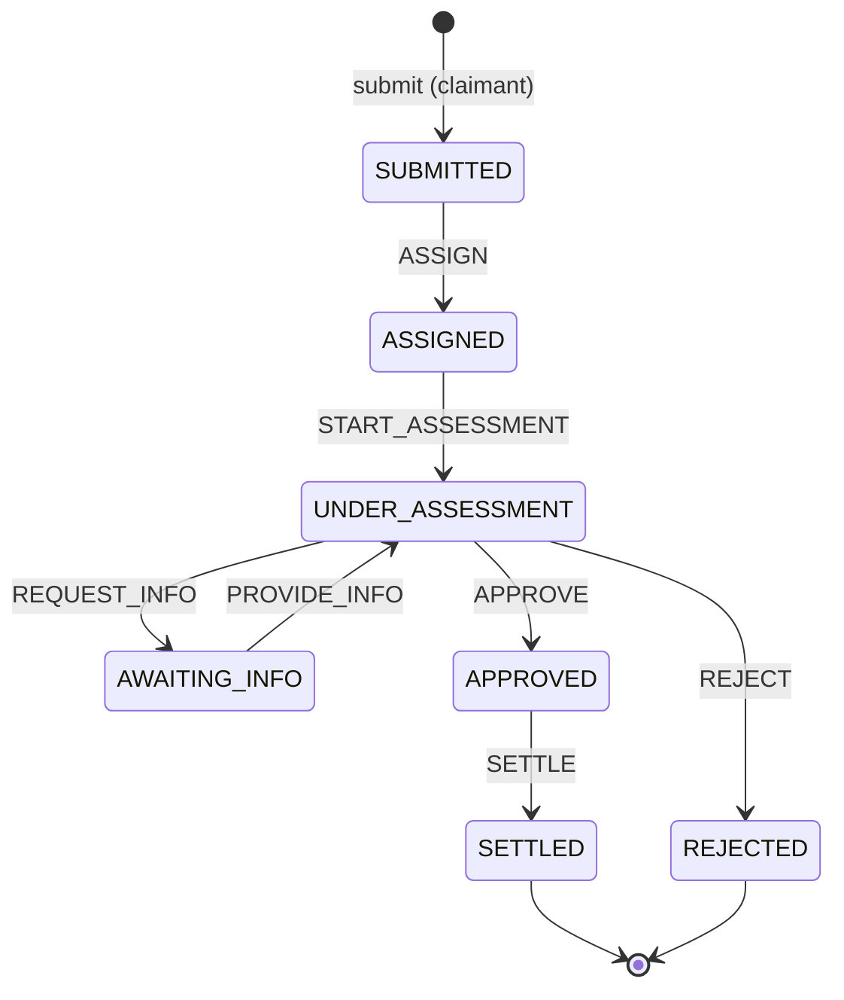

# AI Working Journal - APAC Claims Platform

## Guardrails & Scope
- **Repo:** apac-claims-platform (strictly local; no public hosting or Chubb branding/proprietary assets)
- **Core Split:** REST/HTTP for direct commands and queries; Kafka for claim lifecycle events, workload tracking, and liability exposure updates

## Log Entries
### Entry 1 - Repo & Journal Initialization
- **Prompt / Direction:** Initialized local repository inside C:\Users\Imran\Documents before writing backend or frontend code.
- **Accepted:** Neutral project naming and backend/frontend folder layout.
- **Challenged / Overrode:** Kept the repository strictly local and scoped to core workflows first.
- **Reasoning:** Prevents public exposure and keeps development focused on the core backend and UI requirements.

### Entry 2 - Infra (docker-compose) + Spring Boot skeleton
- **Prompt / Direction:** Asked AI to create `docker-compose.yml` (Postgres + Kafka) and a Spring Boot skeleton in `backend/`, then list the design decisions to confirm before domain logic. Planned first, approved the plan, then let it execute.
- **Accepted:**
  - Single-node Kafka in **KRaft** mode (`apache/kafka:4.1.0`), no ZooKeeper, so there's one fewer container and it's the current Kafka default.
  - Broker topic auto-create **off**. The app declares `claim-events` (3 partitions, keyed by claimId) via a `NewTopic` bean, so topology is versioned with code and events per claim stay ordered.
  - **Flyway owns schema**, `ddl-auto: validate`. No silent Hibernate schema drift.
  - Skeleton generated from start.spring.io, plus springdoc-openapi for a backend-owned API contract.
  - Testcontainers images pinned to the same versions as compose (generator defaulted to `:latest`).
  - Module boundaries recorded as `package-info.java` (claim / workload / exposure / common.events).
- **Challenged / Overrode:**
  - AI's plan said Spring Boot 3.3.x. The generator now defaults to **4.2.0**, and 3.3 is out of support, so I kept 4.2 (still targets Java 17).
  - AI first claimed a JDK 17 was installed. It had misread `JAVA_HOME` (which pointed to a non-existent `jdk-17` folder). The build failure exposed it, and I installed **Temurin JDK 25** myself. A stale user-level `JAVA_HOME` still overrides the correct machine-level one and needs fixing.
  - AI asked about Docker being missing. I installed Docker Desktop rather than accept an H2/embedded-Kafka fallback (prod-like infra > convenience).
  - Rejected Lombok. Records and plain Java mean less generated magic to defend.
- **Decision:** **Modular monolith** over multiple services. With the 2-3h budget, a single transactional boundary for claim state wins; Kafka between modules keeps the split option open.
- **Verified:** `docker compose up -d --wait` shows both healthy; `mvnw verify` passes (context loads with Flyway + Kafka via Testcontainers); app on compose stack gives `/actuator/health` UP, Swagger 200, `claim-events` topic created with 3 partitions.

### Entry 3 - Architecture Summary (blueprint for Steps 2+)
- **Prompt / Direction:** Confirmed 5 decisions (statuses, transactional outbox, per-currency exposure, minimal entities + seeded users, Kafka-fed projections; no custom Kafka health check). Asked AI for one blueprint to build against.
- **Accepted:** Blueprint below. Anything not here is out of scope until it's added here first.

#### A. Shape
One Spring Boot service (modular monolith), one Postgres database, one Kafka topic.
`claim` module is the **only writer** of claim state. `workload`, `exposure` and `timeline` modules are **read models** fed only by Kafka. They hold no foreign keys to claim tables and never read them, so each could move to its own service and DB unchanged.

#### B. Entities and tables
| Table | Purpose | Key relationships / rules |
|---|---|---|
| `app_user` | Seeded users: alice, ben (CLAIMANT); olivia, oscar (OFFICER); maya (MANAGER) | `role` CHECK |
| `policy` | Seeded, minimal: number, market (SG/HK/MY/TH/ID/AU), product (MOTOR/PROPERTY), currency, sum insured, validity | `holder_id → app_user` |
| `claim` | Aggregate root: status, incident date, description, claimed amount, currency (copied from policy), current `reserve_amount`, `settled_amount`, `version` (optimistic lock) | `policy_id → policy`, `claimant_id → app_user`, `assigned_officer_id → app_user` (required once past SUBMITTED) |
| `info_request` | Officer question + claimant response | `claim_id → claim`; **max one open request per claim** (partial unique index) |
| `claim_note` | Internal staff notes (never shown to claimant) | `claim_id → claim` |
| `reserve_change` | Append-only history of reserve (estimated liability) changes | `claim_id → claim` |
| `decision` | Approve (with amount) or reject (with reason) | `claim_id → claim`, **one per claim** |
| `outbox_event` | Events waiting to be published to Kafka | written in the same transaction as the claim change |
| `workload_claim_view` | Projection: status, officer, market/product, timestamps per claim | owned by `workload` |
| `exposure_claim_view` | Projection: currency, reserve, open flag per claim | owned by `exposure` |
| `claim_timeline_entry` | Projection: one row per event, `visible_to_claimant` flag | owned by `timeline`, PK = `event_id` |

Money is `NUMERIC(18,2)` + `CHAR(3)` currency. There's no FX conversion anywhere.

#### C. Lifecycle

| Action | From → To | Allowed roles |
|---|---|---|
| (submit, creates claim) | → SUBMITTED | CLAIMANT (own policy only) |
| ASSIGN | SUBMITTED → ASSIGNED | OFFICER (self pick-up), MANAGER (to any officer) |
| START_ASSESSMENT | ASSIGNED → UNDER_ASSESSMENT | OFFICER, MANAGER |
| REQUEST_INFO | UNDER_ASSESSMENT → AWAITING_INFO | OFFICER, MANAGER |
| PROVIDE_INFO | AWAITING_INFO → UNDER_ASSESSMENT | CLAIMANT (own claim) |
| APPROVE | UNDER_ASSESSMENT → APPROVED | OFFICER, MANAGER |
| REJECT | UNDER_ASSESSMENT → REJECTED | OFFICER, MANAGER |
| SETTLE | APPROVED → SETTLED | OFFICER, MANAGER |

Commands that don't change status: **reassign** (MANAGER, any non-terminal claim), **set reserve** (OFFICER/MANAGER, non-terminal), **add note** (OFFICER/MANAGER).
"Open" means every state except SETTLED and REJECTED. APPROVED-but-unpaid still counts as exposure.
Rules live in one place (`ClaimAction` + `ClaimLifecycle`). The role check runs first and returns 403; a wrong state returns 409.

#### D. REST (synchronous: caller needs an answer or validation error now)
Header `X-User: <username>`. The server loads the user and **takes the role from the DB, never from the request**.
| Method & path | Who | Reads from |
|---|---|---|
| `GET /api/me` | all | app_user |
| `GET /api/policies` | claimant (own) | policy |
| `POST /api/claims` | claimant | → claim + outbox |
| `GET /api/claims` | claimant: own · officer: `?assignee=me\|unassigned` · manager: all | claim |
| `GET /api/claims/{id}` | owner / staff | **claim (direct, always current)** |
| `POST /api/claims/{id}/assign` `{officerId?}` | officer (self), manager | → claim + outbox |
| `POST /api/claims/{id}/start-assessment` | staff | → claim + outbox |
| `POST /api/claims/{id}/info-requests` `{question}` | staff | → info_request + claim + outbox |
| `POST /api/claims/{id}/info-requests/{reqId}/response` `{response}` | claimant (own) | → info_request + claim + outbox |
| `PUT /api/claims/{id}/reserve` `{amount, reason}` | staff | → reserve_change + claim + outbox |
| `POST /api/claims/{id}/decision` `{outcome, amount?, reason}` | staff | → decision + claim + outbox |
| `POST /api/claims/{id}/settlement` `{amount}` | staff | → claim + outbox |
| `POST /api/claims/{id}/notes` | staff | → claim_note |
| `GET /api/claims/{id}/timeline` | owner (filtered) / staff | claim_timeline_entry (eventual) |
| `GET /api/dashboard/workload` | officer (own), manager (all officers + unassigned queue + 30-day closed/avg cycle time) | workload_claim_view (eventual) |
| `GET /api/dashboard/exposure` | manager | exposure_claim_view: `SUM(reserve) WHERE open GROUP BY currency, market, product` (eventual) |

Commands are explicit sub-resources (one per action) rather than `PATCH status`, so each one has its own validation, permission check and event. The backend owns the contract via OpenAPI (`/v3/api-docs`).

#### E. Kafka (asynchronous: fan-out to read models)
- Topic `claim-events`, 3 partitions, **key = claimId** so each claim's events stay in order.
- Envelope: `eventId, eventType, claimId, claimVersion, occurredAt, actorId, payload`.
- Event types: `ClaimSubmitted, ClaimAssigned, ClaimAssessmentStarted, InformationRequested, InformationProvided, ReserveChanged, ClaimApproved, ClaimRejected, ClaimSettled`.
- Each payload carries a snapshot of the claim (status, officerId, market, product, currency, reserve), so consumers never query claim tables.
- Three consumer groups (`workload-projection`, `exposure-projection`, `timeline-projection`), so each read model has its own offsets and a failing one can't block the others.

**Outbox flow**
1. Command handler, in one DB transaction: update `claim` (bumps `version`), write the history row, insert `outbox_event`. If it rolls back, there's no event.
2. Poller (`@Scheduled`, ~500 ms): `SELECT … WHERE published_at IS NULL ORDER BY seq LIMIT 100 FOR UPDATE SKIP LOCKED` → send to Kafka and wait for the ack → set `published_at`. On failure: `attempts++`, `last_error`, **stop the batch** (keeps per-claim order) and retry next tick.
3. This gives **at-least-once** delivery, so consumers are idempotent:
   - timeline: insert keyed on `event_id`; duplicates are ignored.
   - workload/exposure: upsert per claim **only if `claimVersion` > `last_claim_version`**; stale or duplicate events are no-ops.
- Ordering uses an identity `seq` column, not `created_at`, because all rows written in one transaction get the same `now()`.

#### F. Role permissions
| | CLAIMANT | OFFICER | MANAGER |
|---|---|---|---|
| Submit claim / respond to info request | own policies/claims | – | – |
| See claim detail + timeline | own claims, claimant-visible events | all | all |
| Pick up unassigned claim | – | self | – |
| Assign / reassign to officer | – | – | ✓ |
| Assess, request info, reserve, approve/reject, settle, notes | – | claims assigned to them only | any claim |
| Workload dashboard | – | own | team |
| Exposure dashboard | – | – | ✓ |

#### G. Deliberately out of scope
Real authentication/IdP, document uploads, approval authority limits, FX conversion, notifications (email/SMS), teams/regions per officer, cancelling an info request, dead-letter topic.

- **AI choices to review (beyond the 5 confirmed decisions):** role comes from the DB, not a header; three projection tables and three consumer groups rather than one shared view; the outbox orders by `seq`, not `created_at`; the batch stops on the first failure; the DB enforces at most one open info request per claim; exposure totals are computed by query rather than kept as running counters (redelivered events can't double-count); reference data is seeded with a Flyway migration (fine for a demo, not for prod).

### Entry 4 - Step 2: schema migrations, lifecycle rules, unit tests
- **Prompt / Direction:** Build Step 2 strictly against the Entry 3 blueprint: Flyway migrations, claim status transition rules, unit tests. No services/controllers yet.
- **Built:**
  - `V2__core_schema.sql`: app_user, policy, claim, info_request, claim_note, reserve_change, decision. Invariants enforced in SQL too: status CHECK; officer required past SUBMITTED; settled amount required when SETTLED; `closed_at` set exactly when terminal; one open info request per claim (partial unique index); one decision per claim; approve needs an amount and reject must not have one.
  - `V3__outbox_and_projections.sql`: outbox_event (identity `seq` for ordering, partial index on unpublished) plus the three projection tables, with no FKs to the write side.
  - `V4__seed_reference_data.sql`: 5 fictional users (alice, ben, olivia, oscar, maya) and one policy per market (SG, HK, MY, TH, ID, AU) with local currency.
  - `ClaimAction` enum is the single source of truth for from-state, to-state and allowed roles. `ClaimLifecycle` is pure static rules: `transition`, `availableActions` (drives UI buttons later), `nextStatuses`. Two exceptions map to 403 (role) and 409 (state).
  - Tests: `ClaimLifecycleTest` (69 cases, pure unit tests) pins the transition table to the blueprint, checks every invalid (state, action) pair, terminal states, role rules, and that permission is checked before state. `SchemaMigrationTest` (7 cases, real Postgres via Testcontainers) covers seed data and DB constraints.
- **Accepted:** Lifecycle rules as plain Java with no state-machine library. Seven transitions don't justify Spring Statemachine, and an enum table is easier to read, test and defend.
- **AI choices to review:**
  - Ownership (claimant owns the claim, officer is the assignee) is deliberately **not** in `ClaimLifecycle`, because it needs the claim instance. It will be checked in the service layer in Step 3.
  - Left the V1 placeholder untouched. It's already applied in the local DB, and editing it would break Flyway's checksum.
  - Seed data lives in a Flyway migration (demo only).
- **Verified:** `mvnw verify` passes 77 tests with 0 failures. Against the compose DB, Flyway migrated v1→v4 and the app started.

### Entry 5 - Step 3: domain services, outbox, REST API
- **Prompt / Direction:** Implement entities and services for the core tables with ownership/assignment rules, the transactional outbox writer + seq-ordered poller (stop the batch on first failure), and the REST endpoints with `X-User` → DB role lookup and 403/409/validation responses. Add tests.
- **Built:**
  - `user`: `AppUser`, `CurrentUser`, and `CurrentUserArgumentResolver`, which reads `X-User`, looks up the user, and takes the role from the DB (401 if missing or unknown). Also `GET /api/me` and `GET /api/users/officers` (for the manager's assign picker).
  - `policy`: read-only `Policy`; `GET /api/policies` returns a claimant's own policies, or all for staff.
  - `claim`:
    - Entities reference each other **by ID, not `@ManyToOne`** (aggregate boundaries, no lazy-loading surprises).
    - `Claim` owns every state change and routes it through `ClaimLifecycle`. Approve sets reserve = approved amount; reject and settle release the reserve to 0 and set `closedAt`.
    - `ClaimAccess` enforces ownership and assignment. Check order is view (404) → role/assignment (403) → state (409) → business rule (422).
    - Separate `ClaimCommandService` (writes) and `ClaimQueryService` (direct reads).
    - The controller exposes one endpoint per command, and each returns the updated detail including `availableActions`.
  - `outbox`:
    - `OutboxWriter` uses `@Transactional(propagation = MANDATORY)`, so it throws if called outside the claim's transaction.
    - `OutboxPoller` locks the next batch with `FOR UPDATE SKIP LOCKED ORDER BY seq` and waits for each Kafka ack before marking a row published. On the first failure it records `attempts`/`last_error` and stops the batch.
    - `OutboxPollerScheduler` runs every 500 ms, can be disabled by property, and is off in tests.
  - `common.web`: API exception types + RFC 7807 `ProblemDetail` handler. 400 includes `errors` by field; optimistic-lock conflicts → 409.
  - OpenAPI: `X-User` is documented as an API-key header, so Swagger UI's Authorize button works.
- **Key decisions:**
  - **Another claimant's claim returns 404, not 403**, so claim IDs can't be probed for existence. Staff can view any claim, but only the assignee (or a manager) can act on it.
  - **One `/assign` endpoint:** on a SUBMITTED claim it's an assignment (officer self pick-up, or a manager naming an officer). On an open, already-assigned claim it's a manager-only reassignment with no status change.
  - **One event per command.** Approve, reject and settle also move the reserve, but don't emit a separate `ReserveChanged`. The event's snapshot carries the new reserve, and `reserve_change` still records the audit row.
  - **`claimVersion` = JPA `@Version` after `saveAndFlush`**, so each claim's events are numbered 0, 1, 2, …, which is what projections will use to drop stale or duplicate events.
  - **Claimants never see** `reserveAmount`, `reserveHistory` or `notes` (internal estimates and staff notes). Those fields are omitted from the JSON, not sent as null.
  - **Business rules (422):** incident date inside the policy period; claimed/reserve/approved amount ≤ sum insured; settlement ≤ approved amount.
  - **Kafka value is the JSON string** with String serializers, avoiding Jackson 2-vs-3 serializer config in spring-kafka. Consumers parse the envelope themselves.
- **Challenged / corrected during the build:**
  - AI first put the Spring Data repositories as nested interfaces in one file. Spring Data doesn't scan nested repositories by default, so they were split into top-level files before the first run.
  - AI left a dead placeholder method in `ClaimCommandService`. It was removed.
  - AI first checked sum insured *before* the lifecycle transition, so a claim in the wrong state with a large amount got 422 instead of 409. The order was flipped so 409 comes first, and a later 422 still rolls everything back (covered by a test).
  - A Step 2 test (`SchemaMigrationTest`) counted every claim row. It broke once other test classes shared the DB, so it now counts by ID.
  - Test failure traced to Spring 7 `jsonPath().value(List.of(...))`, which converts to the runtime class of the expected value (an internal immutable JDK list) and yields `null`. Switched to Hamcrest `contains(...)`. The API response was correct all along; I verified it by printing the response.
  - `getFirst()`/`getLast()` are Java 21 APIs and the project targets 17. Replaced them with index access.
- **Known limits (not fixed, deliberately):**
  - Multiple app instances could break per-claim ordering, because SKIP LOCKED lets two pollers take different batches at once. Fine for one instance; for more, one poller would need to be elected leader, or rows split by claimId hash. Documented in `OutboxPoller`.
  - Holding a DB transaction while waiting for Kafka acks is acceptable at 100 rows × 5 s timeout. At higher volume, mark rows "in flight" first and send outside the transaction.
  - No pagination on `GET /api/claims` (demo data volume).
  - `jsonb` normalises key order, so the Kafka payload isn't byte-identical to what was written (semantically identical).
  - An empty POST sent with a non-JSON `Content-Type` (PowerShell's default) gets 415. Clients that send JSON or no content type are fine.
- **Verified:**
  - `mvnw verify` passes **126 tests, 0 failures**:
    - lifecycle 69 + entity 8 + access 8 (unit)
    - poller 4 (unit with mocked Kafka)
    - API 25 (MockMvc + Postgres)
    - outbox 4 (Postgres + real Kafka)
    - schema 7 and context 1
  - Manual smoke test on the docker-compose stack, with the scheduled poller on: submitted and assigned a claim over HTTP, both outbox rows marked published, and both messages are on `claim-events` keyed by claimId.

### Entry 6 - Step 4: Kafka projections and read endpoints
- **Prompt / Direction:** Three consumers (workload, exposure, timeline) on `claim-events` with separate groups, reading only events and deduplicating by per-claim version. Exposure totals by query. Dashboard and timeline endpoints with consistent `X-User` role rules. Tests for idempotency and the endpoints.
- **Built:**
  - `common.events.ClaimEventCodec`: single JSON codec used by the outbox writer and all consumers. Amounts in `details` parse as BigDecimal. A corrupt or unknown message is logged and **skipped** (returns empty), because retrying a poison message would block every later event on that partition.
  - `KafkaConsumerConfig`: `DefaultErrorHandler` retries transient failures (e.g. DB down) 5× at 1 s, then logs and moves on. No dead-letter topic (out of scope, Entry 3 G).
  - `workload`, `exposure`, `timeline` packages each have a `…Projection` (`@KafkaListener`, own `groupId`), a JDBC repository, and a controller.
  - `V5__timeline_claimant.sql` adds `claimant_id` to timeline rows (from the event snapshot), so the timeline can authorise claimants without reading claim tables.
  - Endpoints:
    - `GET /api/dashboard/workload` (staff): officers see their own row, managers see every officer, including those with zero claims. Both see the unassigned queue. Figures: open by status, aged (>14 days open), oldest open, closed in the last 30 days, and average days to close.
    - `GET /api/dashboard/exposure` (managers only): outstanding reserve on open claims per currency (never summed across currencies), a market/product breakdown, and a count of open claims with no reserve yet ("unestimated exposure").
    - `GET /api/claims/{id}/timeline`: staff see every entry. Claimants see only claimant-visible entries for their own claims; reserve changes are staff-only.
- **Key decisions:**
  - **Dedupe is a single SQL statement:** `INSERT … ON CONFLICT (claim_id) DO UPDATE … WHERE last_claim_version < EXCLUDED.last_claim_version`. The check and the write are atomic, so there's no read-then-write race, and a duplicate or stale event updates 0 rows.
  - **"Newest version wins" is correct because events carry the full snapshot.** Skipping an older event loses nothing, so even out-of-order delivery (e.g. the multi-instance poller caveat from Entry 5) converges to the right state.
  - **Timeline dedupes on `eventId`, not version.** A timeline wants every event, so the PK on `event_id` plus `ON CONFLICT DO NOTHING` makes redelivery a no-op.
  - **Exposure is `SUM(reserve_amount) WHERE is_open GROUP BY …` over one row per claim.** A redelivered event overwrites a row (or does nothing); it never adds, so double counting is impossible. A settled or rejected claim can't come back through a stale event (tested).
  - **Repositories use JdbcTemplate, not JPA.** The upserts are SQL-specific, and the read models are simple tables with no aggregate behaviour.
  - **A claimant asking for someone else's timeline gets an empty list,** the same as for a claim with no events yet. This keeps the timeline independent of the claim tables, reveals nothing, and avoids returning 404 in the moment between creating a claim and its first event being projected.
  - **Rebuilding read models:** consumers start at `earliest`. To rebuild, truncate a projection table and reset its group's offsets. Verified on compose: the new consumers replayed Step 3's messages into correct rows.
- **Challenged / corrected during the build:**
  - The workload stats query failed: Postgres 14+ `EXTRACT(EPOCH …)` returns `numeric`, and pgjdbc won't convert `numeric` with `getObject(Double.class)`. Cast to `double precision` in SQL. The bug also made the end-to-end test time out, because the workload endpoint returned 500.
  - A literal `null` message would have NPE'd in the codec. Guarded and tested.
  - AI made the JDBC repositories `@Repository` (which adds a proxy) with package-private records exposed in public responses. Switched to `@Component` (JdbcTemplate already translates exceptions) and made the response records public.
  - AI wrote a meaningless assertion (`everyItem(not(is(-1)))` on counts) in the end-to-end test. Replaced it with a real check.
- **Known limits:**
  - Dashboards are eventually consistent (typically <1 s locally) and don't report projection lag.
  - Officer display names come from `app_user` (reference data). In a split-out service that would be an identity lookup.
  - Ordering of timeline entries with an identical `occurred_at` falls back to `event_id`. In practice each command has its own timestamp.
- **Verified:**
  - `mvnw verify` passes **155 tests, 0 failures**. New in this step:
    - codec 3, timeline summaries 11, currency totals 2 (unit)
    - workload 5, exposure 4, timeline 2 (Postgres, synthetic duplicate/stale/replayed events)
    - end-to-end 2: REST → outbox → poller → Kafka → three groups → endpoints, plus role checks
  - Smoke test on compose: V5 applied, three groups each got all 3 partitions, and the dashboards and timeline returned correct data built by replay.
