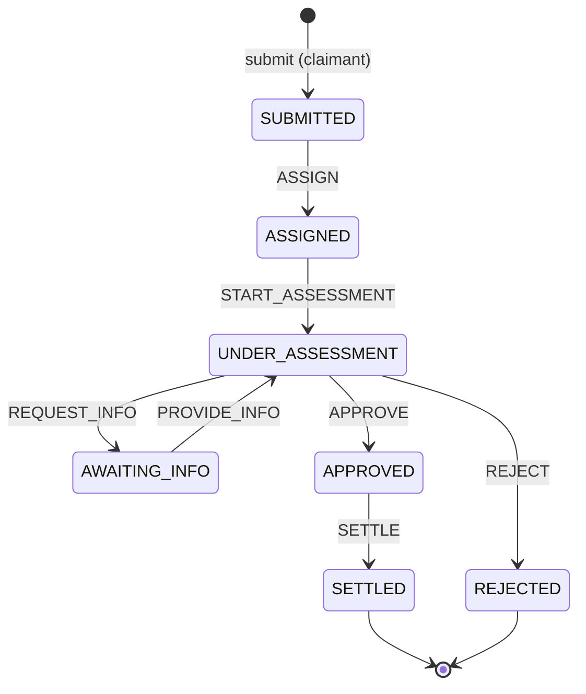

# AI Working Journal - APAC Claims Platform

## Guardrails & Scope
- **Repo:** apac-claims-platform (strictly local; no public hosting or Chubb branding/proprietary assets)
- **Core Split:** REST/HTTP for direct commands and queries; Kafka for claim lifecycle events, workload tracking, and liability exposure updates

## Log Entries
### Entry 1 - Repo & Journal Initialization
- **Prompt / Direction:** Initialized local repository inside C:\Users\Imran\Documents before writing backend or frontend code.
- **Accepted:** Neutral project naming and backend/frontend folder layout.
- **Challenged / Overrode:** Kept the repository strictly local and scoped to core workflows first.
- **Reasoning:** Prevents public exposure and keeps development focused on the core backend and UI requirements.

### Entry 2 - Infra (docker-compose) + Spring Boot skeleton
- **Prompt / Direction:** Asked AI to create `docker-compose.yml` (Postgres + Kafka) and a Spring Boot skeleton in `backend/`, then list the design decisions to confirm before domain logic. Planned first, approved the plan, then let it execute.
- **Accepted:**
  - Single-node Kafka in **KRaft** mode (`apache/kafka:4.1.0`), no ZooKeeper, so there's one fewer container and it's the current Kafka default.
  - Broker topic auto-create **off**. The app declares `claim-events` (3 partitions, keyed by claimId) via a `NewTopic` bean, so topology is versioned with code and events per claim stay ordered.
  - **Flyway owns schema**, `ddl-auto: validate`. No silent Hibernate schema drift.
  - Skeleton generated from start.spring.io, plus springdoc-openapi for a backend-owned API contract.
  - Testcontainers images pinned to the same versions as compose (generator defaulted to `:latest`).
  - Module boundaries recorded as `package-info.java` (claim / workload / exposure / common.events).
- **Challenged / Overrode:**
  - AI's plan said Spring Boot 3.3.x. The generator now defaults to **4.2.0**, and 3.3 is out of support, so I kept 4.2 (still targets Java 17).
  - AI first claimed a JDK 17 was installed. It had misread `JAVA_HOME` (which pointed to a non-existent `jdk-17` folder). The build failure exposed it, and I installed **Temurin JDK 25** myself. A stale user-level `JAVA_HOME` still overrides the correct machine-level one and needs fixing.
  - AI asked about Docker being missing. I installed Docker Desktop rather than accept an H2/embedded-Kafka fallback (prod-like infra > convenience).
  - Rejected Lombok. Records and plain Java mean less generated magic to defend.
- **Decision:** **Modular monolith** over multiple services. With the 2-3h budget, a single transactional boundary for claim state wins; Kafka between modules keeps the split option open.
- **Verified:** `docker compose up -d --wait` shows both healthy; `mvnw verify` passes (context loads with Flyway + Kafka via Testcontainers); app on compose stack gives `/actuator/health` UP, Swagger 200, `claim-events` topic created with 3 partitions.

### Entry 3 - Architecture Summary (blueprint for Steps 2+)
- **Prompt / Direction:** Confirmed 5 decisions (statuses, transactional outbox, per-currency exposure, minimal entities + seeded users, Kafka-fed projections; no custom Kafka health check). Asked AI for one blueprint to build against.
- **Accepted:** Blueprint below. Anything not here is out of scope until it's added here first.

#### A. Shape
One Spring Boot service (modular monolith), one Postgres database, one Kafka topic.
`claim` module is the **only writer** of claim state. `workload`, `exposure` and `timeline` modules are **read models** fed only by Kafka. They hold no foreign keys to claim tables and never read them, so each could move to its own service and DB unchanged.

#### B. Entities and tables
| Table | Purpose | Key relationships / rules |
|---|---|---|
| `app_user` | Seeded users: alice, ben (CLAIMANT); olivia, oscar (OFFICER); maya (MANAGER) | `role` CHECK |
| `policy` | Seeded, minimal: number, market (SG/HK/MY/TH/ID/AU), product (MOTOR/PROPERTY), currency, sum insured, validity | `holder_id → app_user` |
| `claim` | Aggregate root: status, incident date, description, claimed amount, currency (copied from policy), current `reserve_amount`, `settled_amount`, `version` (optimistic lock) | `policy_id → policy`, `claimant_id → app_user`, `assigned_officer_id → app_user` (required once past SUBMITTED) |
| `info_request` | Officer question + claimant response | `claim_id → claim`; **max one open request per claim** (partial unique index) |
| `claim_note` | Internal staff notes (never shown to claimant) | `claim_id → claim` |
| `reserve_change` | Append-only history of reserve (estimated liability) changes | `claim_id → claim` |
| `decision` | Approve (with amount) or reject (with reason) | `claim_id → claim`, **one per claim** |
| `outbox_event` | Events waiting to be published to Kafka | written in the same transaction as the claim change |
| `workload_claim_view` | Projection: status, officer, market/product, timestamps per claim | owned by `workload` |
| `exposure_claim_view` | Projection: currency, reserve, open flag per claim | owned by `exposure` |
| `claim_timeline_entry` | Projection: one row per event, `visible_to_claimant` flag | owned by `timeline`, PK = `event_id` |

Money is `NUMERIC(18,2)` + `CHAR(3)` currency. There's no FX conversion anywhere.

#### C. Lifecycle

| Action | From → To | Allowed roles |
|---|---|---|
| (submit, creates claim) | → SUBMITTED | CLAIMANT (own policy only) |
| ASSIGN | SUBMITTED → ASSIGNED | OFFICER (self pick-up), MANAGER (to any officer) |
| START_ASSESSMENT | ASSIGNED → UNDER_ASSESSMENT | OFFICER, MANAGER |
| REQUEST_INFO | UNDER_ASSESSMENT → AWAITING_INFO | OFFICER, MANAGER |
| PROVIDE_INFO | AWAITING_INFO → UNDER_ASSESSMENT | CLAIMANT (own claim) |
| APPROVE | UNDER_ASSESSMENT → APPROVED | OFFICER, MANAGER |
| REJECT | UNDER_ASSESSMENT → REJECTED | OFFICER, MANAGER |
| SETTLE | APPROVED → SETTLED | OFFICER, MANAGER |

Commands that don't change status: **reassign** (MANAGER, any non-terminal claim), **set reserve** (OFFICER/MANAGER, non-terminal), **add note** (OFFICER/MANAGER).
"Open" means every state except SETTLED and REJECTED. APPROVED-but-unpaid still counts as exposure.
Rules live in one place (`ClaimAction` + `ClaimLifecycle`). The role check runs first and returns 403; a wrong state returns 409.

#### D. REST (synchronous: caller needs an answer or validation error now)
Header `X-User: <username>`. The server loads the user and **takes the role from the DB, never from the request**.
| Method & path | Who | Reads from |
|---|---|---|
| `GET /api/me` | all | app_user |
| `GET /api/policies` | claimant (own) | policy |
| `POST /api/claims` | claimant | → claim + outbox |
| `GET /api/claims` | claimant: own · officer: `?assignee=me\|unassigned` · manager: all | claim |
| `GET /api/claims/{id}` | owner / staff | **claim (direct, always current)** |
| `POST /api/claims/{id}/assign` `{officerId?}` | officer (self), manager | → claim + outbox |
| `POST /api/claims/{id}/start-assessment` | staff | → claim + outbox |
| `POST /api/claims/{id}/info-requests` `{question}` | staff | → info_request + claim + outbox |
| `POST /api/claims/{id}/info-requests/{reqId}/response` `{response}` | claimant (own) | → info_request + claim + outbox |
| `PUT /api/claims/{id}/reserve` `{amount, reason}` | staff | → reserve_change + claim + outbox |
| `POST /api/claims/{id}/decision` `{outcome, amount?, reason}` | staff | → decision + claim + outbox |
| `POST /api/claims/{id}/settlement` `{amount}` | staff | → claim + outbox |
| `POST /api/claims/{id}/notes` | staff | → claim_note |
| `GET /api/claims/{id}/timeline` | owner (filtered) / staff | claim_timeline_entry (eventual) |
| `GET /api/dashboard/workload` | officer (own), manager (all officers + unassigned queue + 30-day closed/avg cycle time) | workload_claim_view (eventual) |
| `GET /api/dashboard/exposure` | manager | exposure_claim_view: `SUM(reserve) WHERE open GROUP BY currency, market, product` (eventual) |

Commands are explicit sub-resources (one per action) rather than `PATCH status`, so each one has its own validation, permission check and event. The backend owns the contract via OpenAPI (`/v3/api-docs`).

#### E. Kafka (asynchronous: fan-out to read models)
- Topic `claim-events`, 3 partitions, **key = claimId** so each claim's events stay in order.
- Envelope: `eventId, eventType, claimId, claimVersion, occurredAt, actorId, payload`.
- Event types: `ClaimSubmitted, ClaimAssigned, ClaimAssessmentStarted, InformationRequested, InformationProvided, ReserveChanged, ClaimApproved, ClaimRejected, ClaimSettled`.
- Each payload carries a snapshot of the claim (status, officerId, market, product, currency, reserve), so consumers never query claim tables.
- Three consumer groups (`workload-projection`, `exposure-projection`, `timeline-projection`), so each read model has its own offsets and a failing one can't block the others.

**Outbox flow**
1. Command handler, in one DB transaction: update `claim` (bumps `version`), write the history row, insert `outbox_event`. If it rolls back, there's no event.
2. Poller (`@Scheduled`, ~500 ms): `SELECT … WHERE published_at IS NULL ORDER BY seq LIMIT 100 FOR UPDATE SKIP LOCKED` → send to Kafka and wait for the ack → set `published_at`. On failure: `attempts++`, `last_error`, **stop the batch** (keeps per-claim order) and retry next tick.
3. This gives **at-least-once** delivery, so consumers are idempotent:
   - timeline: insert keyed on `event_id`; duplicates are ignored.
   - workload/exposure: upsert per claim **only if `claimVersion` > `last_claim_version`**; stale or duplicate events are no-ops.
- Ordering uses an identity `seq` column, not `created_at`, because all rows written in one transaction get the same `now()`.

#### F. Role permissions
| | CLAIMANT | OFFICER | MANAGER |
|---|---|---|---|
| Submit claim / respond to info request | own policies/claims | – | – |
| See claim detail + timeline | own claims, claimant-visible events | all | all |
| Pick up unassigned claim | – | self | – |
| Assign / reassign to officer | – | – | ✓ |
| Assess, request info, reserve, approve/reject, settle, notes | – | claims assigned to them only | any claim |
| Workload dashboard | – | own | team |
| Exposure dashboard | – | – | ✓ |

#### G. Deliberately out of scope
Real authentication/IdP, document uploads, approval authority limits, FX conversion, notifications (email/SMS), teams/regions per officer, cancelling an info request, dead-letter topic.

- **AI choices to review (beyond the 5 confirmed decisions):** role comes from the DB, not a header; three projection tables and three consumer groups rather than one shared view; the outbox orders by `seq`, not `created_at`; the batch stops on the first failure; the DB enforces at most one open info request per claim; exposure totals are computed by query rather than kept as running counters (redelivered events can't double-count); reference data is seeded with a Flyway migration (fine for a demo, not for prod).

### Entry 4 - Step 2: schema migrations, lifecycle rules, unit tests
- **Prompt / Direction:** Build Step 2 strictly against the Entry 3 blueprint: Flyway migrations, claim status transition rules, unit tests. No services/controllers yet.
- **Built:**
  - `V2__core_schema.sql`: app_user, policy, claim, info_request, claim_note, reserve_change, decision. Invariants enforced in SQL too: status CHECK; officer required past SUBMITTED; settled amount required when SETTLED; `closed_at` set exactly when terminal; one open info request per claim (partial unique index); one decision per claim; approve needs an amount and reject must not have one.
  - `V3__outbox_and_projections.sql`: outbox_event (identity `seq` for ordering, partial index on unpublished) plus the three projection tables, with no FKs to the write side.
  - `V4__seed_reference_data.sql`: 5 fictional users (alice, ben, olivia, oscar, maya) and one policy per market (SG, HK, MY, TH, ID, AU) with local currency.
  - `ClaimAction` enum is the single source of truth for from-state, to-state and allowed roles. `ClaimLifecycle` is pure static rules: `transition`, `availableActions` (drives UI buttons later), `nextStatuses`. Two exceptions map to 403 (role) and 409 (state).
  - Tests: `ClaimLifecycleTest` (69 cases, pure unit tests) pins the transition table to the blueprint, checks every invalid (state, action) pair, terminal states, role rules, and that permission is checked before state. `SchemaMigrationTest` (7 cases, real Postgres via Testcontainers) covers seed data and DB constraints.
- **Accepted:** Lifecycle rules as plain Java with no state-machine library. Seven transitions don't justify Spring Statemachine, and an enum table is easier to read, test and defend.
- **AI choices to review:**
  - Ownership (claimant owns the claim, officer is the assignee) is deliberately **not** in `ClaimLifecycle`, because it needs the claim instance. It will be checked in the service layer in Step 3.
  - Left the V1 placeholder untouched. It's already applied in the local DB, and editing it would break Flyway's checksum.
  - Seed data lives in a Flyway migration (demo only).
- **Verified:** `mvnw verify` passes 77 tests with 0 failures. Against the compose DB, Flyway migrated v1→v4 and the app started.
